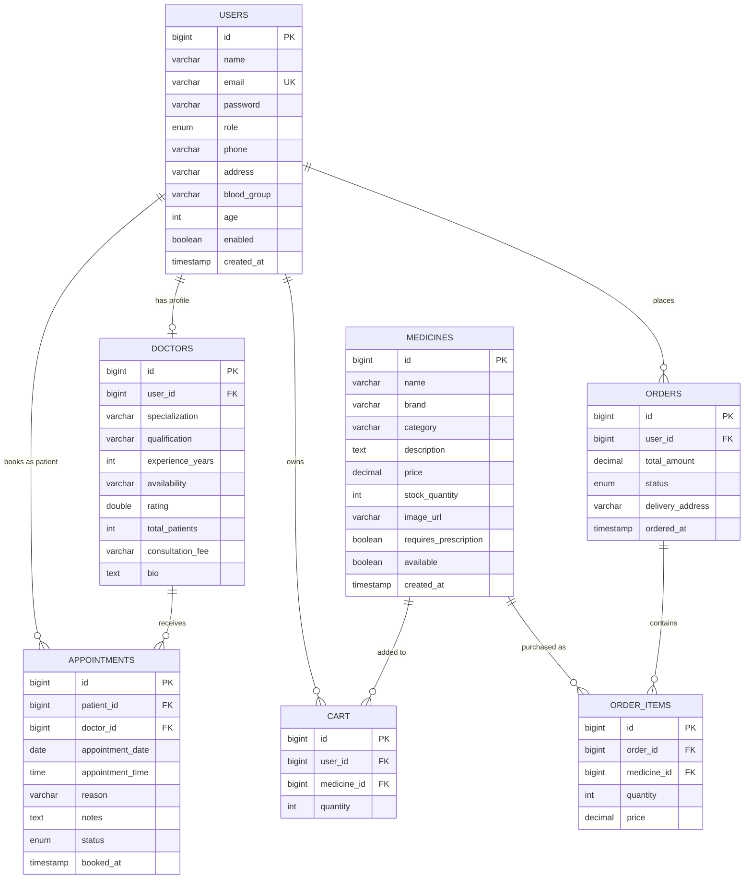
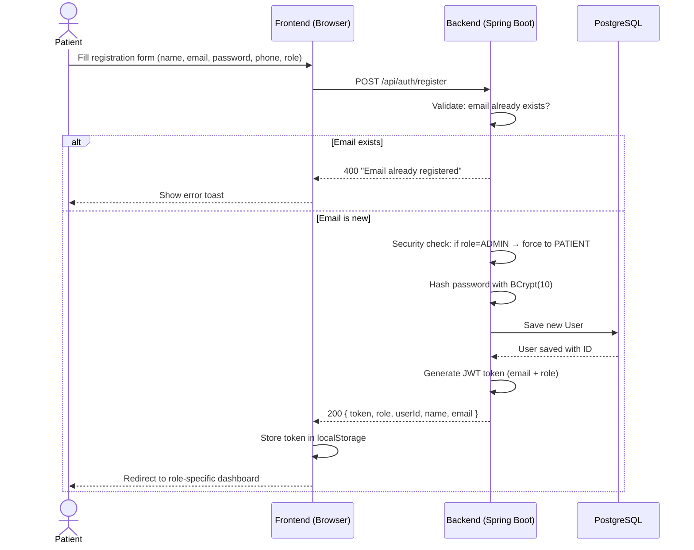
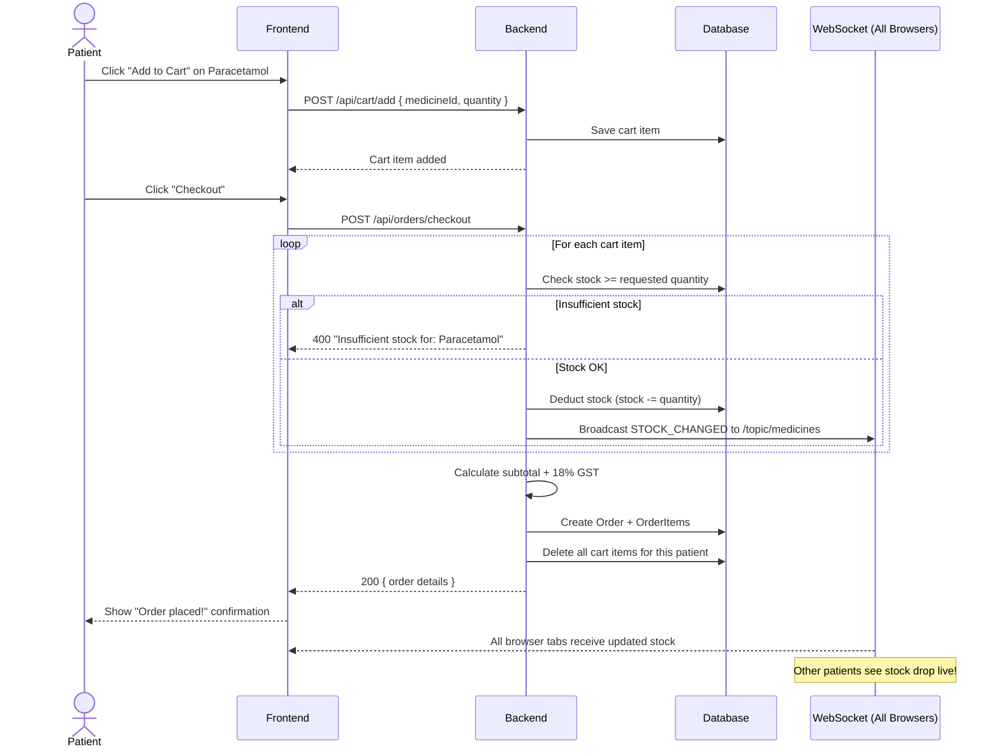
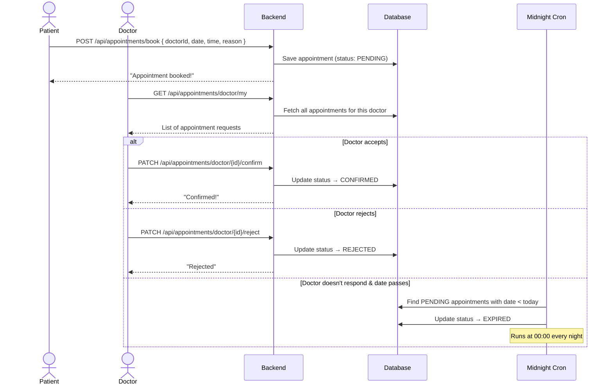
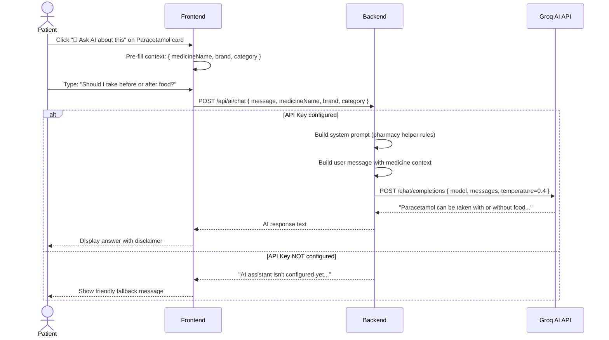
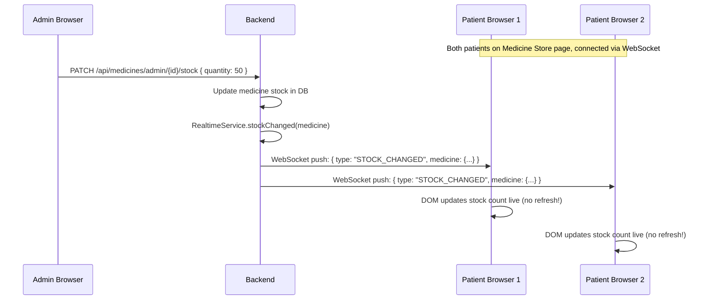

# 🏥 MedCare — Full Stack Healthcare Platform
## Software Development Life Cycle (SDLC) Document

| Field | Detail |
|---|---|
| **Project Name** | MedCare — E-Commerce Medicine & Doctor Appointment Booking System |
| **Version** | 1.0.0 |
| **Date** | October 2026 |
| **Author** | MedCare Development Team |
| **Status** | Production-Ready |

---

# Table of Contents

1. [Problem Analysis & Business Case](#1-problem-analysis--business-case)
2. [Functional Requirements](#2-functional-requirements)
3. [Non-Functional Requirements](#3-non-functional-requirements)
4. [System Architecture & Design](#4-system-architecture--design)
5. [Module Breakdown & Step-by-Step Plan](#5-module-breakdown--step-by-step-plan)
6. [Feature Flows — How Every Feature Works](#6-feature-flows--how-every-feature-works)
7. [Technology Stack — What & Why](#7-technology-stack--what--why)
8. [How It All Works Together — End-to-End](#8-how-it-all-works-together--end-to-end)
9. [Deployment Strategy](#9-deployment-strategy)
10. [Maintenance, Scalability & Future Roadmap](#10-maintenance-scalability--future-roadmap)

---

# 1. Problem Analysis & Business Case

## 1.1 The Problem

In India, patients face several critical pain points when it comes to healthcare:

| Problem | Impact |
|---|---|
| **No single platform** for buying medicine AND booking doctor appointments | Patients juggle 2-3 different apps (PharmEasy for meds, Practo for doctors, WhatsApp for follow-ups) |
| **Manual pharmacy visits** waste hours | Standing in line at a pharmacy for common medicines like Paracetamol or Cetirizine |
| **Appointment booking is phone-based** | Calling a clinic, being put on hold, no confirmation — leads to missed or double-booked slots |
| **No real-time stock visibility** | Patient drives to pharmacy only to find the medicine is out of stock |
| **Zero transparency in orders** | Once an order is placed offline, patient has no way to track if it's shipped/delivered |
| **Admin chaos** | Small pharmacy owners manage stock in notebooks, have no low-stock alerts, no digital user management |

## 1.2 The Proposed Solution

Build **MedCare** — a single, unified full-stack web platform that solves **all** these problems:

```
┌──────────────────────────────────────────────────────────┐
│                     MedCare Platform                     │
├────────────────┬─────────────────┬───────────────────────┤
│   Patient      │    Doctor       │      Admin            │
│ ─ Buy Medicine │ ─ View Requests │ ─ Manage Stock        │
│ ─ Book Doctor  │ ─ Accept/Reject │ ─ Track All Orders    │
│ ─ Track Orders │ ─ Patient List  │ ─ Manage Users        │
│ ─ AI Assistant │                 │ ─ Low-Stock Alerts    │
│ ─ Profile Mgmt │                 │ ─ Dashboard & Stats   │
└────────────────┴─────────────────┴───────────────────────┘
```

## 1.3 Target Users

| User Role | Who Are They? | What Do They Need? |
|---|---|---|
| **Patient** | Any individual needing medicine or a doctor consultation | Easy browsing, cart, checkout, appointment booking, order tracking |
| **Doctor** | Licensed medical practitioner registered on the platform | Dashboard to view/accept/reject patient appointment requests |
| **Admin** | Pharmacy owner or platform operator | Full control: stock, orders, users, analytics, alerts |

## 1.4 Business Value

> [!IMPORTANT]
> MedCare is not just a CRUD app — it is a **business-ready platform** with real-time stock sync, AI-assisted medicine queries, role-based security, and production deployment.

- **Revenue Model**: Commission on medicine sales + Doctor consultation fees
- **Competitive Advantage**: Single platform for medicine + appointments + AI assistance
- **Scalability**: Designed to onboard multiple pharmacies and doctor networks

---

# 2. Functional Requirements

## 2.1 Authentication & User Management Module

| ID | Requirement | Priority | User |
|---|---|---|---|
| FR-01 | User can register with name, email, password, phone, role (Patient/Doctor) | Must Have | All |
| FR-02 | User can log in with email & password, receive JWT token | Must Have | All |
| FR-03 | System prevents self-registration as ADMIN (security safeguard) | Must Have | System |
| FR-04 | User can view their profile (name, email, phone, address, blood group, age) | Must Have | All |
| FR-05 | User can update their profile details | Should Have | All |
| FR-06 | Admin can suspend/enable any user account | Must Have | Admin |
| FR-07 | Admin can delete user accounts | Must Have | Admin |
| FR-08 | Suspended users receive "Account suspended" on login attempt | Must Have | System |

## 2.2 Medicine Catalog Module

| ID | Requirement | Priority | User |
|---|---|---|---|
| FR-09 | Anyone (even without login) can browse the medicine catalog | Must Have | Public |
| FR-10 | Anyone can search medicines by name keyword | Must Have | Public |
| FR-11 | Anyone can view a specific medicine's details (name, brand, category, price, stock, prescription-required flag) | Must Have | Public |
| FR-12 | Admin can add new medicines to the catalog | Must Have | Admin |
| FR-13 | Admin can edit existing medicine details | Must Have | Admin |
| FR-14 | Admin can delete medicines | Must Have | Admin |
| FR-15 | Admin can update stock quantity for a medicine | Must Have | Admin |
| FR-16 | Admin can view all low-stock medicines (threshold-based alert) | Should Have | Admin |

## 2.3 Shopping Cart Module

| ID | Requirement | Priority | User |
|---|---|---|---|
| FR-17 | Patient can add medicines to their cart | Must Have | Patient |
| FR-18 | Patient can view their cart | Must Have | Patient |
| FR-19 | Patient can update quantity of a cart item | Must Have | Patient |
| FR-20 | Patient can remove a single item from cart | Must Have | Patient |
| FR-21 | Patient can clear their entire cart | Should Have | Patient |

## 2.4 Order Management Module

| ID | Requirement | Priority | User |
|---|---|---|---|
| FR-22 | Patient can checkout — system deducts stock, calculates 18% GST, creates order | Must Have | Patient |
| FR-23 | System validates stock availability before checkout (rejects if insufficient) | Must Have | System |
| FR-24 | Patient can view their order history (sorted newest first) | Must Have | Patient |
| FR-25 | Patient can view a specific order's details (items, amounts, status) | Must Have | Patient |
| FR-26 | Admin can view ALL orders from all patients | Must Have | Admin |
| FR-27 | Admin can update order status (PROCESSING → SHIPPED → DELIVERED / CANCELLED) | Must Have | Admin |

## 2.5 Appointment Booking Module

| ID | Requirement | Priority | User |
|---|---|---|---|
| FR-28 | Patient can browse the list of available doctors (public, no login needed) | Must Have | Public |
| FR-29 | Patient can book an appointment with a doctor (date, time, reason) | Must Have | Patient |
| FR-30 | Patient can view their appointments | Must Have | Patient |
| FR-31 | Patient can cancel a PENDING appointment | Must Have | Patient |
| FR-32 | Doctor can view their appointment requests | Must Have | Doctor |
| FR-33 | Doctor can confirm (accept) an appointment | Must Have | Doctor |
| FR-34 | Doctor can reject an appointment | Must Have | Doctor |
| FR-35 | Admin can view ALL appointments across the platform | Must Have | Admin |
| FR-36 | System auto-expires PENDING appointments past their date (midnight cron job) | Should Have | System |

## 2.6 AI Chat Assistant Module

| ID | Requirement | Priority | User |
|---|---|---|---|
| FR-37 | Patient can ask the AI assistant about medicines (usage, precautions, alternatives) | Nice to Have | Patient |
| FR-38 | AI provides general pharmacology info with a mandatory disclaimer | Nice to Have | System |
| FR-39 | If AI_API_KEY is not set, system gracefully returns a "not configured" message | Nice to Have | System |

## 2.7 Real-Time Updates Module

| ID | Requirement | Priority | User |
|---|---|---|---|
| FR-40 | Medicine stock changes broadcast live to all connected browsers (no refresh needed) | Should Have | All |
| FR-41 | Order status changes push live to the specific patient's browser | Should Have | Patient |

## 2.8 Admin Dashboard Module

| ID | Requirement | Priority | User |
|---|---|---|---|
| FR-42 | Admin can see platform-wide statistics (total users, orders, medicines, appointments) | Must Have | Admin |
| FR-43 | Admin can view and manage all users | Must Have | Admin |

---

# 3. Non-Functional Requirements

## 3.1 Security

| ID | Requirement | Implementation |
|---|---|---|
| NFR-01 | All passwords must be hashed (never stored in plain text) | BCrypt with strength factor 10 |
| NFR-02 | API endpoints must be authenticated via stateless tokens | JWT (HMAC-SHA256), 24-hour expiry |
| NFR-03 | Role-based access control (RBAC) must prevent unauthorized access | Spring Security `@PreAuthorize` + SecurityFilterChain |
| NFR-04 | ADMIN role cannot be self-registered from client | Server-side guard in AuthController |
| NFR-05 | Internal error messages must NEVER leak to the client | GlobalExceptionHandler returns correlation IDs, logs details server-side |
| NFR-06 | CORS must be restricted to explicit allowed origins | No wildcard `*`; configurable via env var |
| NFR-07 | Docker containers must run as non-root users | `adduser medcare` + `USER medcare` in Dockerfile |

## 3.2 Performance

| ID | Requirement | Implementation |
|---|---|---|
| NFR-08 | Database connection pooling for efficient resource usage | HikariCP: max-pool=10, min-idle=2, idle-timeout=30s |
| NFR-09 | Open-in-view disabled to prevent lazy-loading issues | `spring.jpa.open-in-view=false` |
| NFR-10 | AI requests must timeout to avoid blocking the server | WebClient timeout: 20 seconds |
| NFR-11 | Real-time updates must not require polling | WebSocket (STOMP + SockJS) — server pushes, no client polling |

## 3.3 Reliability & Availability

| ID | Requirement | Implementation |
|---|---|---|
| NFR-12 | Application must auto-seed demo data on fresh database | `DataSeeder` (CommandLineRunner) runs once on startup |
| NFR-13 | Stale appointments must be automatically cleaned up | `AppointmentExpiryService` runs nightly cron at midnight |
| NFR-14 | WebSocket connections must auto-retry on disconnect | Client-side SockJS reconnects every 5 seconds |
| NFR-15 | AI feature must gracefully degrade if API key is missing | Returns friendly message instead of error |

## 3.4 Maintainability

| ID | Requirement | Implementation |
|---|---|---|
| NFR-16 | Configuration must be externalized (no hardcoded secrets) | All secrets/URLs via environment variables with sensible defaults |
| NFR-17 | Code must follow layered architecture | Controller → Service → Repository → Entity |
| NFR-18 | Logging must use structured patterns with severity levels | SLF4J + Logback, configurable log levels |

## 3.5 Portability & Deployment

| ID | Requirement | Implementation |
|---|---|---|
| NFR-19 | Application must be containerized | Multi-stage Docker build (Maven build → JRE Alpine runtime) |
| NFR-20 | One-click deployment to cloud | Render Blueprint (render.yaml) auto-provisions DB + app |
| NFR-21 | Database URL must work across local/cloud environments | `DatabaseUrlPostProcessor` normalizes `postgresql://` to `jdbc:postgresql://` |

---

# 4. System Architecture & Design

## 4.1 High-Level Architecture

```
┌─────────────────────────────────────────────────────────────────────┐
│                        CLIENT LAYER (Browser)                       │
│  ┌───────────────────────────────────────────────────────────────┐  │
│  │   index.html — Single-Page Application (Vanilla JS + CSS)    │  │
│  │   ├── Auth Pages (Login / Register)                          │  │
│  │   ├── Medicine Store (Browse, Search, Cart, AI Chat)         │  │
│  │   ├── Doctor Listing & Appointment Booking                   │  │
│  │   ├── Patient Dashboard (Orders, Appointments, Profile)      │  │
│  │   ├── Doctor Dashboard (Appointment Requests)                │  │
│  │   └── Admin Dashboard (Stats, Medicines, Orders, Users)      │  │
│  └───────────────────────────┬───────────────────────────────────┘  │
│                              │ HTTP REST + WebSocket (STOMP/SockJS) │
└──────────────────────────────┼──────────────────────────────────────┘
                               │
┌──────────────────────────────┼──────────────────────────────────────┐
│                    SERVER LAYER (Spring Boot)                       │
│  ┌───────────────────────────┴───────────────────────────────────┐  │
│  │                   Security Layer                              │  │
│  │   JwtAuthFilter → Token Validation → SecurityContext          │  │
│  │   BCrypt Password Hashing │ Role-Based Access Control         │  │
│  ├───────────────────────────┴───────────────────────────────────┤  │
│  │                   Controller Layer (REST API)                 │  │
│  │   AuthController │ MedicineController │ CartController        │  │
│  │   OrderController │ AppointmentController │ DoctorController  │  │
│  │   AdminController │ AiChatController                         │  │
│  ├───────────────────────────────────────────────────────────────┤  │
│  │                   Service Layer                               │  │
│  │   RealtimeService (WebSocket push)                           │  │
│  │   AiChatService (Groq API integration)                       │  │
│  │   AppointmentExpiryService (Nightly cron)                    │  │
│  ├───────────────────────────────────────────────────────────────┤  │
│  │                   Repository Layer (Spring Data JPA)          │  │
│  │   UserRepo │ MedicineRepo │ DoctorRepo │ CartRepo            │  │
│  │   OrderRepo │ AppointmentRepo                                │  │
│  ├───────────────────────────────────────────────────────────────┤  │
│  │                   Entity Layer (JPA/Hibernate)                │  │
│  │   User │ Medicine │ Doctor │ Cart │ Order │ OrderItem         │  │
│  │   Appointment                                                │  │
│  └───────────────────────────┬───────────────────────────────────┘  │
└──────────────────────────────┼──────────────────────────────────────┘
                               │
┌──────────────────────────────┼──────────────────────────────────────┐
│                    DATA LAYER                                       │
│  ┌───────────────────────────┴───────────────────────────────────┐  │
│  │              PostgreSQL 14+ (medcare_db)                      │  │
│  │   Tables: users, doctors, medicines, cart, orders,            │  │
│  │           order_items, appointments                           │  │
│  └───────────────────────────────────────────────────────────────┘  │
└─────────────────────────────────────────────────────────────────────┘
                               │
┌──────────────────────────────┼──────────────────────────────────────┐
│                    EXTERNAL SERVICES                                │
│  ┌───────────────────────────┴───────────────────────────────────┐  │
│  │  Groq AI API (OpenAI-compatible chat completions endpoint)    │  │
│  │  Model: openai/gpt-oss-20b (free tier, no credit card)       │  │
│  └───────────────────────────────────────────────────────────────┘  │
└─────────────────────────────────────────────────────────────────────┘
```

## 4.2 Database Entity-Relationship Diagram



## 4.3 Security Architecture Flow

```
Patient Browser                    Spring Boot Server                    Database
     │                                    │                                │
     │── POST /api/auth/login ──────────▶│                                │
     │   { email, password }             │                                │
     │                                   │── Authenticate ──────────────▶│
     │                                   │   BCrypt.matches(password,     │
     │                                   │   stored_hash)                 │
     │                                   │◀── User Found ───────────────│
     │                                   │                                │
     │                                   │── Generate JWT Token           │
     │                                   │   (HMAC-SHA256, 24h expiry,    │
     │                                   │    contains: email + role)     │
     │                                   │                                │
     │◀── { token, role, userId } ──────│                                │
     │                                   │                                │
     │ (Browser stores token in memory)  │                                │
     │                                   │                                │
     │── GET /api/orders/my ────────────▶│                                │
     │   Header: Authorization:          │                                │
     │   Bearer <jwt_token>              │                                │
     │                                   │                                │
     │                          ┌────────┴────────┐                       │
     │                          │  JwtAuthFilter   │                       │
     │                          │  1. Extract token │                      │
     │                          │  2. Verify sig    │                      │
     │                          │  3. Check expiry  │                      │
     │                          │  4. Load user     │                      │
     │                          │  5. Set context   │                      │
     │                          └────────┬────────┘                       │
     │                                   │                                │
     │                          ┌────────┴────────┐                       │
     │                          │ SecurityFilter   │                      │
     │                          │ Check: role has   │                      │
     │                          │ access to this    │                      │
     │                          │ endpoint?         │                      │
     │                          └────────┬────────┘                       │
     │                                   │                                │
     │                                   │── Query orders ──────────────▶│
     │                                   │◀── Return results ───────────│
     │◀── { orders: [...] } ────────────│                                │
```

---

# 5. Module Breakdown & Step-by-Step Plan

## 5.1 Development Plan — How to Build This from Scratch

If a company wanted to build MedCare from day 1, here is the exact phase-by-phase plan:

### Phase 1: Foundation (Week 1-2)

| Step | Task | Deliverable |
|---|---|---|
| 1 | Set up Spring Boot project with Maven | Working `pom.xml` with all dependencies |
| 2 | Configure PostgreSQL connection + HikariCP pool | `application.properties` with externalized config |
| 3 | Create all 7 JPA entities with relationships | `User`, `Doctor`, `Medicine`, `Cart`, `Order`, `OrderItem`, `Appointment` |
| 4 | Create all 6 Spring Data JPA repositories | Auto-generated CRUD + custom queries |
| 5 | Build `DataSeeder` to auto-populate on first run | Admin, 5 doctors, 2 patients, 10 medicines |
| 6 | Set up global exception handling | `GlobalExceptionHandler` with correlation IDs |

### Phase 2: Security (Week 3)

| Step | Task | Deliverable |
|---|---|---|
| 7 | Implement `JwtUtil` for token generation/validation | HMAC-SHA256 signing, 24h expiry, role claim |
| 8 | Implement `JwtAuthFilter` for request interception | Extract → Validate → Load User → Set Context |
| 9 | Implement `UserDetailsServiceImpl` | Bridge between Spring Security and our User entity |
| 10 | Configure `SecurityConfig` | Public endpoints, ADMIN-only, DOCTOR-only, PATIENT-only |
| 11 | Add CORS configuration | Explicit origins only, no wildcard |

### Phase 3: Core API (Week 4-5)

| Step | Task | Deliverable |
|---|---|---|
| 12 | Build `AuthController` (register, login, me, profile) | `/api/auth/**` endpoints |
| 13 | Build `MedicineController` (CRUD + search + stock) | `/api/medicines/**` endpoints |
| 14 | Build `CartController` (add, view, update, remove, clear) | `/api/cart/**` endpoints |
| 15 | Build `OrderController` (checkout with GST, history, admin status update) | `/api/orders/**` endpoints |
| 16 | Build `AppointmentController` (book, view, cancel, accept, reject) | `/api/appointments/**` endpoints |
| 17 | Build `DoctorController` (list, details, admin add) | `/api/doctors/**` endpoints |
| 18 | Build `AdminController` (stats, user management) | `/api/admin/**` endpoints |

### Phase 4: Advanced Features (Week 6)

| Step | Task | Deliverable |
|---|---|---|
| 19 | Set up WebSocket with STOMP + SockJS | `WebSocketConfig` with `/ws` endpoint |
| 20 | Build `RealtimeService` for live medicine stock & order updates | Push to `/topic/medicines` and `/topic/orders/{userId}` |
| 21 | Integrate AI Chat via Groq API | `AiChatService` with system prompt, fallback handling |
| 22 | Build `AppointmentExpiryService` | Midnight cron job for stale PENDING appointments |

### Phase 5: Frontend (Week 7-8)

| Step | Task | Deliverable |
|---|---|---|
| 23 | Build single-page `index.html` with all views | Complete frontend in vanilla HTML/CSS/JS |
| 24 | Wire up REST API calls with JWT token handling | Fetch API with Authorization header |
| 25 | Wire up WebSocket for live updates | SockJS + STOMP.js subscription |
| 26 | Implement AI chat panel on Medicine Store page | Floating chat UI with medicine context |

### Phase 6: Deployment (Week 9)

| Step | Task | Deliverable |
|---|---|---|
| 27 | Create multi-stage Dockerfile | Build stage (Maven) → Run stage (JRE Alpine) |
| 28 | Create `render.yaml` Blueprint | Auto-provision PostgreSQL + Docker web service |
| 29 | Configure environment variables on Render | DB, JWT secret, CORS origins, AI API key |
| 30 | Deploy, test, seed, verify | Live production URL |

---

# 6. Feature Flows — How Every Feature Works

## 6.1 User Registration Flow



## 6.2 Medicine Purchase (Cart → Checkout) Flow



## 6.3 Doctor Appointment Flow



## 6.4 AI Medicine Assistant Flow



## 6.5 Real-Time Stock Sync Flow



## 6.6 Admin Order Status Update Flow

```
Admin clicks "Mark as Shipped" on Order #42 (belongs to Patient Priya)
    │
    ▼
PATCH /api/orders/admin/42/status?status=SHIPPED
    │
    ▼
Backend saves new status → Calls realtimeService.orderStatusChanged(priyaUserId, 42, "SHIPPED")
    │
    ▼
WebSocket pushes to /topic/orders/{priyaUserId}
    │
    ▼
Priya's browser (if on "My Orders" page) receives live update → status badge changes to "SHIPPED" instantly
```

---

# 7. Technology Stack — What & Why

## 7.1 Complete Tech Stack

| Layer | Technology | Version | Why This Choice? |
|---|---|---|---|
| **Language** | Java | 17 (LTS) | Enterprise-grade, strong typing, LTS support until 2029 |
| **Framework** | Spring Boot | 3.2.5 | De-facto Java web framework; auto-config, embedded server, huge ecosystem |
| **Security** | Spring Security | 6.x | Industry-standard auth/authz; integrates natively with Spring Boot |
| **Auth Tokens** | JWT (jjwt) | 0.12.3 | Stateless authentication; no server-side session storage needed |
| **Password Hashing** | BCrypt | strength=10 | Adaptive hashing; slow enough to resist brute-force, fast enough for UX |
| **ORM** | Hibernate (JPA) | 6.x | Object-relational mapping; write Java, generate SQL automatically |
| **Database** | PostgreSQL | 14+ | Free, ACID-compliant, excellent JSON support, battle-tested at scale |
| **Connection Pool** | HikariCP | Built-in | Fastest JDBC connection pool; default in Spring Boot |
| **WebSocket** | STOMP + SockJS | Built-in | Full-duplex real-time push; SockJS provides fallback for older browsers |
| **Reactive HTTP** | WebClient (WebFlux) | Built-in | Non-blocking HTTP client for calling the external AI API |
| **AI Integration** | Groq API | Free tier | OpenAI-compatible API; free, no credit card, fast inference |
| **Frontend** | HTML5 + CSS3 + JS | — | Zero build step, served as static file from Spring Boot itself |
| **Build Tool** | Maven | 3.9 | Dependency management, reproducible builds, plugin ecosystem |
| **Containerization** | Docker | Multi-stage | Consistent environments; build once, run anywhere |
| **Deployment** | Render | Free tier | One-click deploy with Blueprint; auto-provisions DB + app |

## 7.2 Dependency Map (from pom.xml)

```
spring-boot-starter-parent (3.2.5)
├── spring-boot-starter-web         → REST API, embedded Tomcat, Jackson JSON
├── spring-boot-starter-security    → Authentication, authorization, filters
├── spring-boot-starter-data-jpa    → Hibernate ORM, Spring Data repositories
├── spring-boot-starter-validation  → @NotBlank, @Valid request validation
├── spring-boot-starter-websocket   → STOMP, SockJS, SimpMessagingTemplate
├── spring-boot-starter-webflux     → WebClient for non-blocking AI API calls
├── postgresql (runtime)            → JDBC driver for PostgreSQL
├── jjwt-api (0.12.3)              → JWT token creation API
├── jjwt-impl (runtime)            → JWT implementation (signing, parsing)
├── jjwt-jackson (runtime)         → JWT JSON serialization via Jackson
└── spring-boot-starter-test        → JUnit 5, Mockito (test scope)
```

## 7.3 How the Layers Connect

```
                  ┌─────────────────┐
                  │   Browser/SPA   │
                  │  (index.html)   │
                  └────────┬────────┘
                           │ HTTP + WebSocket
                  ┌────────▼────────┐
                  │   Embedded      │
                  │   Tomcat 10     │
                  │   (Port 8080)   │
                  └────────┬────────┘
                           │
              ┌────────────▼────────────┐
              │    JwtAuthFilter        │ ← Intercepts every request
              │    (OncePerRequestFilter)│
              └────────────┬────────────┘
                           │
              ┌────────────▼────────────┐
              │   SecurityFilterChain   │ ← Role-based route matching
              └────────────┬────────────┘
                           │
         ┌─────────────────┼─────────────────┐
         │                 │                 │
  ┌──────▼──────┐  ┌──────▼──────┐  ┌──────▼──────┐
  │ Controllers │  │  Services   │  │ WebSocket   │
  │ (REST API)  │──▶│ (Business   │  │ Config      │
  │             │  │  Logic)     │  │             │
  └──────┬──────┘  └──────┬──────┘  └─────────────┘
         │                │
         └────────┬───────┘
                  │
         ┌────────▼────────┐
         │  Repositories   │ ← Spring Data JPA
         │ (Data Access)   │
         └────────┬────────┘
                  │
         ┌────────▼────────┐
         │   Hibernate     │ ← ORM: Java Objects ↔ SQL
         └────────┬────────┘
                  │
         ┌────────▼────────┐
         │  HikariCP       │ ← Connection Pool
         │  (max=10)       │
         └────────┬────────┘
                  │
         ┌────────▼────────┐
         │  PostgreSQL     │ ← Persistent Storage
         │  (medcare_db)   │
         └─────────────────┘
```

---

# 8. How It All Works Together — End-to-End

## 8.1 Example: A Patient's Complete Journey

Let's walk through a real scenario from start to finish:

### Step 1: Registration
```
Patient Priya opens http://localhost:8080 → Sees the landing page
Clicks "Register" → Fills: Name="Priya Rao", Email="priya@gmail.com", Password="test123", Role=PATIENT
Browser sends: POST /api/auth/register { ... }
Server: Validates email is unique → Hashes password → Saves to DB → Generates JWT → Returns token
Browser: Stores token → Redirects to Patient Dashboard
```

### Step 2: Browse & Search Medicines
```
Priya clicks "Buy Medicines" → Browser sends: GET /api/medicines/list
Server: Returns all 10 seeded medicines (public, no auth needed)
Priya types "paracetamol" → Browser sends: GET /api/medicines/search?q=paracetamol
Server: Returns matching medicines
```

### Step 3: Ask AI About a Medicine
```
Priya clicks "🤖 Ask AI about this" on Paracetamol card
Types: "Can I take this with coffee?"
Browser sends: POST /api/ai/chat { message: "Can I take this with coffee?", medicineName: "Paracetamol 500mg", ... }
Server → Groq AI → "Paracetamol can be taken with or without food, including coffee..."
Browser: Shows AI answer with disclaimer
```

### Step 4: Add to Cart & Checkout
```
Priya clicks "Add to Cart" on Paracetamol (qty: 2) and Cetirizine (qty: 1)
Browser sends: POST /api/cart/add for each

Priya clicks "Checkout"
Browser sends: POST /api/orders/checkout
Server:
  - Checks stock for each item ✅
  - Deducts stock: Paracetamol 250→248, Cetirizine 180→179
  - Broadcasts stock changes via WebSocket (all browsers see it live!)
  - Calculates: Subtotal = ₹18×2 + ₹22×1 = ₹58.00
  - GST (18%) = ₹10.44
  - Total = ₹68.44
  - Creates Order (status: PROCESSING) with 2 OrderItems
  - Clears Priya's cart
  - Returns order confirmation
```

### Step 5: Admin Processes the Order
```
Admin logs in → Goes to "Orders" tab → Sees Priya's order
Clicks "Mark as Shipped" → PATCH /api/orders/admin/{id}/status?status=SHIPPED
Server: Updates status → Pushes WebSocket to /topic/orders/{priyaUserId}

Priya's browser (if open): Order status badge changes to "SHIPPED" live!
```

### Step 6: Book a Doctor Appointment
```
Priya clicks "Book Appointment" → Sees list of 5 doctors
Selects "Dr. Arjun Mehta (Cardiologist)"
Picks date: Nov 5, time: 10:00 AM, reason: "Chest pain"
Browser sends: POST /api/appointments/book { doctorId, date, time, reason }
Server: Saves appointment (status: PENDING)

Dr. Arjun logs in → Sees appointment request → Clicks "Confirm"
Server: Updates status → CONFIRMED
```

## 8.2 Application Startup Sequence

```
1. JVM starts → Spring Boot bootstraps
2. application.properties loaded → Environment variables resolved
3. DatabaseUrlPostProcessor normalizes DB URL (postgresql:// → jdbc:postgresql://)
4. HikariCP creates connection pool (min-idle=2, max=10)
5. Hibernate scans @Entity classes → Creates/updates tables (ddl-auto=update)
6. SecurityConfig initializes → BCrypt encoder, JWT filter, CORS config
7. WebSocketConfig initializes → /ws endpoint with STOMP + SockJS
8. DataSeeder runs (CommandLineRunner) →
   - Checks if users table is empty
   - If empty: Seeds admin, 5 doctors, 2 patients, 10 medicines
   - If not empty: Skips (idempotent)
9. AppointmentExpiryService scheduled → Cron registered for midnight
10. Tomcat starts on port 8080 → Application ready!

Total startup time: ~5-8 seconds
```

---

# 9. Deployment Strategy

## 9.1 Deployment Architecture

```
┌────────────────────────────────────────────────────────────────┐
│                     Render Cloud Platform                       │
│                                                                │
│  ┌──────────────────────┐     ┌──────────────────────────────┐ │
│  │  PostgreSQL Database  │     │    Docker Web Service        │ │
│  │  ─────────────────── │     │    ────────────────────────── │ │
│  │  Plan: Free           │◀───│    Plan: Free                │ │
│  │  DB: medcare_db       │    │    Dockerfile: Multi-stage   │ │
│  │  Auto-provisioned     │    │    Port: 8080                │ │
│  │  via render.yaml      │    │    Non-root user: medcare    │ │
│  └──────────────────────┘     └──────────────────────────────┘ │
│                                                                │
│  Environment Variables (set in Render Dashboard):              │
│  ├── JDBC_DATABASE_URL (auto from DB)                          │
│  ├── DB_USERNAME / DB_PASSWORD (auto from DB)                  │
│  ├── JWT_SECRET (manual: openssl rand -base64 48)              │
│  ├── CORS_ALLOWED_ORIGINS (manual: https://medcare-xxx.render) │
│  ├── AI_API_KEY (manual: from console.groq.com)                │
│  └── DDL_AUTO=update                                           │
└────────────────────────────────────────────────────────────────┘
```

## 9.2 Docker Multi-Stage Build — How It Works

```dockerfile
# Stage 1: BUILD (heavyweight — Maven + JDK)
# ──────────────────────────────────────────
FROM maven:3.9-eclipse-temurin-17 AS build    # Full JDK + Maven
WORKDIR /app
COPY pom.xml .                                 # Copy dependency list first
RUN mvn dependency:go-offline -B               # Download all deps (cached layer)
COPY src ./src                                 # Copy source code
RUN mvn clean package -DskipTests -B           # Build JAR (skip tests for speed)
# Output: /app/target/medcare-1.0.0.jar

# Stage 2: RUN (lightweight — JRE only)
# ──────────────────────────────────────
FROM eclipse-temurin:17-jre-alpine             # ~80MB (vs ~400MB for JDK)
WORKDIR /app
RUN addgroup -S medcare && adduser -S medcare -G medcare  # Non-root user
USER medcare                                   # Security: no root access
COPY --from=build /app/target/medcare-1.0.0.jar app.jar   # Copy only the JAR
EXPOSE 8080
ENTRYPOINT ["java", "-jar", "app.jar"]         # Start the application
```

> [!TIP]
> The multi-stage build means the final Docker image is ~80MB (JRE Alpine) instead of ~400MB (full JDK + Maven). Dependencies are cached in a separate layer, so rebuilds are fast.

## 9.3 Step-by-Step Deployment Process

| Step | Action | Command / Location |
|---|---|---|
| 1 | Push code to GitHub | `git push origin main` |
| 2 | Go to Render Dashboard | https://dashboard.render.com |
| 3 | Click "New → Blueprint" | Connect your GitHub repo |
| 4 | Render detects `render.yaml` | Auto-provisions PostgreSQL + Docker service |
| 5 | Set `JWT_SECRET` env var | Render dashboard → Environment → `openssl rand -base64 48` |
| 6 | Set `CORS_ALLOWED_ORIGINS` | Your Render URL: `https://medcare-xxxx.onrender.com` |
| 7 | (Optional) Set `AI_API_KEY` | From https://console.groq.com/keys |
| 8 | Deploy triggers automatically | Docker builds → Container starts → DB seeds on first run |
| 9 | Verify | Visit your Render URL → Login with `admin@medcare.com / admin123` |

## 9.4 Local Development Setup

```bash
# Prerequisites: Java 17+, Maven 3.8+, PostgreSQL 14+

# 1. Create database
psql -U postgres -c "CREATE DATABASE medcare_db;"

# 2. Configure (edit application.properties or set env vars)
export DB_PASSWORD=your_postgres_password

# 3. Build & Run
cd medcare
mvn clean install
mvn spring-boot:run

# 4. Open browser
# http://localhost:8080

# Demo accounts auto-created:
# admin@medcare.com / admin123
# patient@medcare.com / patient123
# arjun@medcare.com / doctor123
```

---

# 10. Maintenance, Scalability & Future Roadmap

## 10.1 Maintenance Strategy

### Configuration Management

| What | How | Where |
|---|---|---|
| Database credentials | Environment variables | `DB_USERNAME`, `DB_PASSWORD` |
| JWT secret | Environment variable | `JWT_SECRET` (rotate periodically) |
| AI provider/model | Environment variables | `AI_API_URL`, `AI_API_KEY`, `AI_API_MODEL` |
| CORS origins | Environment variable | `CORS_ALLOWED_ORIGINS` |
| Log levels | Environment variable | `APP_LOG_LEVEL` (DEBUG/INFO/WARN/ERROR) |
| DB schema migration | `DDL_AUTO` env var | Set `validate` in production (use Flyway/Liquibase for migrations) |

### Error Monitoring

```
Every unhandled exception:
1. Gets a unique correlation ID (8-char UUID)
2. Full stack trace logged server-side: log.error("ref={}", refId, ex)
3. Client receives ONLY: "Something went wrong (ref: a3f2b1c9)"
4. Support team can search logs by ref ID to diagnose

This prevents information leakage while maintaining debuggability.
```

### Automated Housekeeping

| Task | Frequency | Implementation |
|---|---|---|
| Expire stale PENDING appointments | Nightly at midnight | `AppointmentExpiryService` (`@Scheduled` cron) |
| WebSocket reconnection on disconnect | Every 5 seconds | Client-side SockJS auto-retry |
| Database connection health check | Continuous | HikariCP automatic validation |

## 10.2 Scalability Plan

### Current Capacity (Single Instance)

| Metric | Capacity |
|---|---|
| Concurrent DB connections | 10 (HikariCP max-pool) |
| WebSocket connections | ~1000 per instance (Tomcat default) |
| Request throughput | ~500 req/sec (typical Spring Boot on 1 vCPU) |
| Database | Single PostgreSQL instance |

### Horizontal Scaling Path

```
Current (Phase 1):                    Scaled (Phase 2):
┌─────────────┐                      ┌──────────────────────────┐
│ Single      │                      │  Load Balancer (Nginx)   │
│ Instance    │                      └──────┬──────┬───────────┘
│ App + DB    │                             │      │
└─────────────┘                      ┌──────▼──┐ ┌─▼───────┐
                                     │ App #1  │ │ App #2  │
                                     │ (Docker)│ │ (Docker)│
                                     └────┬────┘ └───┬─────┘
                                          │          │
                                     ┌────▼──────────▼─────┐
                                     │ PostgreSQL (Primary) │
                                     │  + Read Replicas     │
                                     └──────────────────────┘
```

### What to Change for Scale

| Area | Current | Scaled Solution |
|---|---|---|
| **Sessions** | JWT (stateless) ✅ | Already scalable — no sticky sessions needed |
| **WebSocket** | In-memory SimpleBroker | Replace with Redis/RabbitMQ broker (multi-instance WebSocket) |
| **Database** | Single PostgreSQL | Add read replicas; partition tables by date |
| **Connection Pool** | max=10 | Increase to 20-50 based on load testing |
| **Caching** | None | Add Redis cache for medicine catalog (invalidate on update) |
| **Static Assets** | Served by Spring Boot | Move to CDN (CloudFront/Cloudflare) |
| **AI API** | Synchronous WebClient | Move to async with @Async + CompletableFuture |
| **Schema Mgmt** | `ddl-auto=update` | Switch to Flyway/Liquibase for versioned migrations |

## 10.3 Security Maintenance Checklist

> [!CAUTION]
> These items must be reviewed periodically to maintain a secure production deployment.

| Frequency | Action |
|---|---|
| Monthly | Rotate JWT_SECRET (redeploy; all tokens invalidate, users re-login) |
| Monthly | Check Groq API model deprecation page (models retire without warning) |
| Quarterly | Update Spring Boot + dependencies (security patches) |
| Quarterly | Review CORS_ALLOWED_ORIGINS (remove stale origins) |
| On-demand | Review user accounts — disable suspicious/inactive accounts |
| On-demand | Check Render logs for `ref=` error correlation IDs |

## 10.4 Future Roadmap (Planned Features)

| Feature | Priority | Effort | Description |
|---|---|---|---|
| 💳 **Payment Gateway** | High | 2 weeks | Razorpay integration for real payments during checkout |
| 📄 **Prescription Upload** | High | 1 week | PDF/image upload for prescription-required medicines |
| 💬 **Doctor-Patient Chat** | Medium | 2 weeks | Real-time chat via WebSocket (infra already exists, reuse `/ws`) |
| 📧 **Email Notifications** | Medium | 1 week | Spring Mail: order confirmation, appointment reminders |
| 📊 **Admin Analytics Charts** | Low | 1 week | Charts.js or similar for visual stats dashboard |
| 🔔 **Push Notifications** | Low | 1 week | Browser notifications for order updates, appointment reminders |
| 📱 **Mobile App** | Low | 4 weeks | React Native consuming the same REST API |

## 10.5 Key File Reference

| File | Purpose | Location |
|---|---|---|
| `MedCareApplication.java` | Application entry point | [MedCareApplication.java](file:///d:/medcare-1/medcare/src/main/java/com/medcare/MedCareApplication.java) |
| `SecurityConfig.java` | JWT + CORS + RBAC configuration | [SecurityConfig.java](file:///d:/medcare-1/medcare/src/main/java/com/medcare/config/SecurityConfig.java) |
| `JwtUtil.java` | Token generation & validation | [JwtUtil.java](file:///d:/medcare-1/medcare/src/main/java/com/medcare/security/JwtUtil.java) |
| `JwtAuthFilter.java` | Request interceptor for auth | [JwtAuthFilter.java](file:///d:/medcare-1/medcare/src/main/java/com/medcare/security/JwtAuthFilter.java) |
| `DataSeeder.java` | Auto-seed database on first run | [DataSeeder.java](file:///d:/medcare-1/medcare/src/main/java/com/medcare/config/DataSeeder.java) |
| `GlobalExceptionHandler.java` | Centralized error handling | [GlobalExceptionHandler.java](file:///d:/medcare-1/medcare/src/main/java/com/medcare/config/GlobalExceptionHandler.java) |
| `WebSocketConfig.java` | Real-time WebSocket setup | [WebSocketConfig.java](file:///d:/medcare-1/medcare/src/main/java/com/medcare/config/WebSocketConfig.java) |
| `RealtimeService.java` | Medicine stock & order push | [RealtimeService.java](file:///d:/medcare-1/medcare/src/main/java/com/medcare/service/RealtimeService.java) |
| `AiChatService.java` | AI medicine assistant | [AiChatService.java](file:///d:/medcare-1/medcare/src/main/java/com/medcare/service/AiChatService.java) |
| `AppointmentExpiryService.java` | Nightly stale appointment cleanup | [AppointmentExpiryService.java](file:///d:/medcare-1/medcare/src/main/java/com/medcare/service/AppointmentExpiryService.java) |
| `AuthController.java` | Login/Register/Profile API | [AuthController.java](file:///d:/medcare-1/medcare/src/main/java/com/medcare/controller/AuthController.java) |
| `OrderController.java` | Cart checkout & order mgmt | [OrderController.java](file:///d:/medcare-1/medcare/src/main/java/com/medcare/controller/OrderController.java) |
| `application.properties` | All externalized configuration | [application.properties](file:///d:/medcare-1/medcare/src/main/resources/application.properties) |
| `pom.xml` | Maven dependencies & build | [pom.xml](file:///d:/medcare-1/medcare/pom.xml) |
| `Dockerfile` | Multi-stage Docker build | [Dockerfile](file:///d:/medcare-1/medcare/Dockerfile) |
| `render.yaml` | Render deployment blueprint | [render.yaml](file:///d:/medcare-1/render.yaml) |

---


---

*Document Version: 1.0 | Last Updated: October 2026 | MedCare Development Team*
